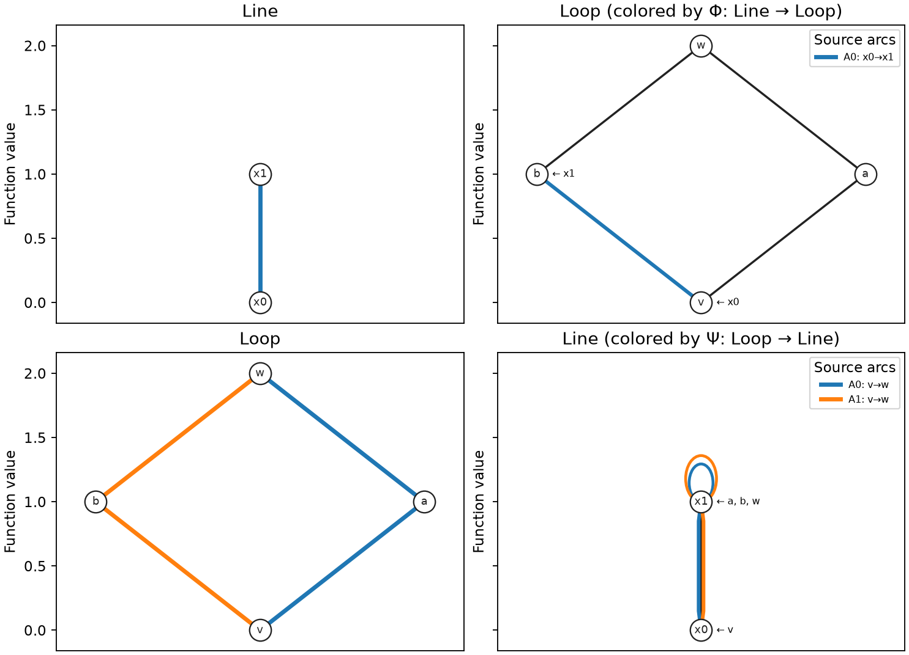

# Mapper Functional Distortion

This repository implements the construction and evaluation of continuous
piecewise-linear maps between the geometric realizations of two Mapper graphs.
Given an interleaving computed with [ceREEBerus](https://github.com/MunchLab/ceREEBerus),
it constructs a map in each direction between the original graphs. The
functional distortion of the resulting map pair gives a computable upper
bound on the functional distortion distance.

## Getting started

From the repository root, create and activate the Conda environment, then open
the [tutorial notebook](fd_tutorial.ipynb).

```sh
conda env create -f environment.yml
conda activate fdenv
python -m jupyterlab fd_tutorial.ipynb
```

To use your own ceREEBerus `MapperGraph` objects, follow the same three steps.

1. Create `Interleave(graph_a, graph_b)` and call its `fit()` method.
2. Pass the fitted object to `maps_from_interleave` to get the original graph realizations `F` and `G` and the maps `Phi` and `Psi`.
3. Call `functional_distortion(F, G, Phi, Psi)` and read the score from `result["FD"]`.

Follow the tutorial notebook to see the full workflow.

## Worked example

A line with height range 0–1 and a loop with height range 0–2. Each row
shows the source on the left and the target colored by the map on the right.



The maximum height errors are 0 for Φ and 1 for Ψ. The distance distortion
term is D = ½, so the functional distortion of the map pair is **1**.

